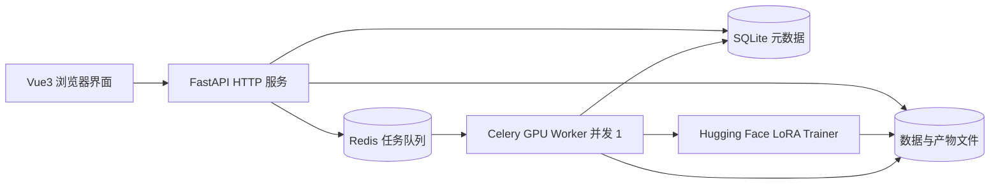
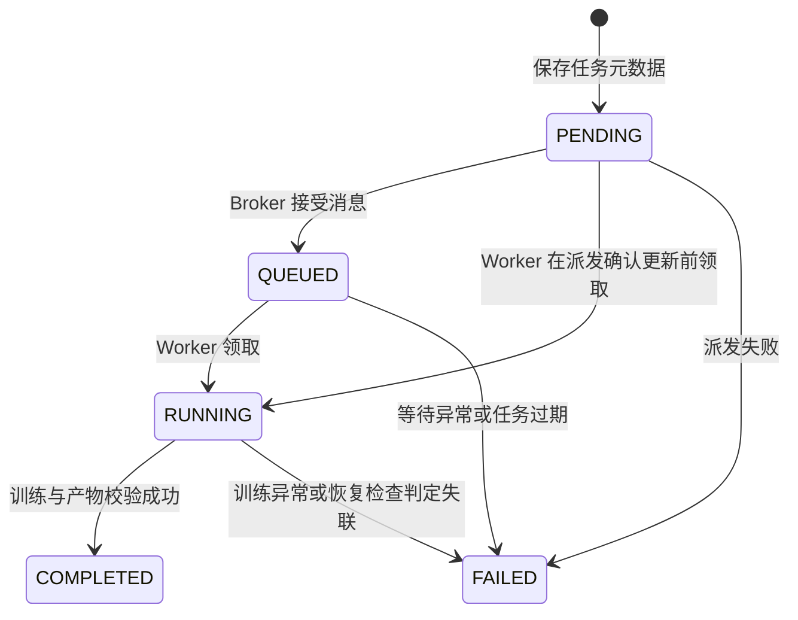

# 系统架构

## 一、组件与职责



该图描述 MVP 目标架构。M0 已实现健康检查、模型目录、元数据建表、Worker 配置和诊断任务；业务服务与真实训练后续实现。

| 模块 | 输入 | 输出 | 职责边界 |
| --- | --- | --- | --- |
| `backend/app/api` | HTTP 请求 | JSON 或受控文件响应 | 校验、状态码与序列化 |
| `backend/app/services` | 已校验的业务参数 | 实体与调度结果 | 数据管理、状态转换和产物访问 |
| `backend/app/models` | ORM 数据/Schema | 持久化实体与接口类型 | 元数据结构和参数契约 |
| `worker/tasks.py` | 数据库任务 ID | 更新状态与产物元数据 | 领取任务、调用训练器、捕获错误 |
| `trainer/train.py` | TrainRequest | TrainResult 与进度回调 | 模型训练，独立于 HTTP/Celery |
| `trainer/dataset.py` | 数据文件路径 | 校验后的训练样本 | 格式读取与验证 |
| `frontend/src` | API 响应与用户操作 | 页面与图表 | 轮询、上传、任务与结果展示 |

API 进程不加载模型和执行 GPU 计算。Celery 消息仅包含任务 ID，不传输数据文件或模型权重。Trainer 接口不依赖数据库和 Celery。

## 二、训练调用与文件契约

`train(request, on_progress) -> TrainResult`：

- `TrainRequest`：task_id、dataset_path、output_dir、base_model、TrainingConfig。
- `TrainingProgress`：step、total_steps、loss；后续扩展 learning_rate、epoch 与时间戳。
- `TrainResult`：adapter_dir、metrics_path；返回前必须校验产物可用。
- Trainer 在回调中提供真实指标，Worker 写入文件并更新数据库进度。回调不依赖 HTTP 请求生命周期。

文件规划：

```text
data/
├── llmcloud.db
├── datasets/{dataset_id}/train.jsonl
├── models/huggingface/                 # HF 缓存
└── outputs/{task_id}/
    ├── adapter/                       # adapter_model.safetensors 与 adapter_config.json
    ├── tokenizer/                     # 推理所需 tokenizer/template 信息
    ├── checkpoints/                   # 中间检查点
    ├── metrics.jsonl                  # 真实指标，逐行追加
    ├── training_config.json           # 配置快照
    └── manifest.json                  # 基础模型 revision、版本、结果清单
logs/
└── tasks/{task_id}.log
```

每个任务独立目录，禁止覆盖其他任务。完成时先写入并校验产物，再更新 COMPLETED。Adapter 下载打包必要配置、tokenizer 和清单，不包含基础模型或原始训练数据。

## 三、数据库与任务状态

初始表：

- `users`：ID、用户名、创建时间；MVP 单用户使用，认证尚未实现。
- `datasets`：ID、可选用户 ID、名称、存储路径、大小、记录数、创建时间。
- `training_tasks`：ID、数据集 ID、模型、训练参数 JSON、状态、Celery ID、进度与步数、产物路径、错误、创建/开始/结束时间。

SQLite 适合本地单 API/单 Worker。使用短事务、外键约束与 busy timeout，后续数据管理阶段按需启用 WAL。多进程部署和结构变更时引入 PostgreSQL 与 Alembic；M0 的 `create_all` 仅创建缺失表，不迁移已有表。



数据库是业务状态的唯一来源，不能将 Celery 的 `SUCCESS` 直接作为训练完成。使用条件更新领取任务，重复消息不会重复运行；API 更新 QUEUED 时只允许从 PENDING 转换，不能覆盖 RUNNING。此状态逻辑将在 M3 实现。

数据库提交与 Redis 派发不是同一事务。MVP 需要保留派发失败原因，并在启动/定时恢复检查中处理长期 PENDING/QUEUED/RUNNING；稳定性扩展阶段可采用 outbox。初始化不启用自动重试或晚确认，避免在没有幂等和恢复逻辑时自动重复训练。

## 四、GPU 资源与可观测性

- 一个 GPU 只启动一个 Worker，使用 `solo` 池、并发 1、prefetch 1，减少 CUDA 进程派生问题与排队任务占用。
- 多开两个并发 1 的 Worker 仍会争抢 GPU，必须在部署层限制 Worker 数量。
- 后续训练与推理共用主机级 GPU 锁，训练期间推理返回资源忙；单进程并发配置本身不足以约束其他进程。
- 初始 batch size=1、序列长度=512，按实测调整梯度累积与精度。显存峰值、训练耗时和吞吐量写入实验记录。
- 前端先每 2 秒轮询任务和增量指标；日志只读取有上限的尾部，暂不引入 WebSocket。
- 训练异常保存可读原因与任务日志，处理完成后释放模型引用与显存；无法安全恢复时重启 Worker。

## 五、部署演进

1. **本地 WSL2**：Vue 开发服务 + FastAPI + Redis + SQLite + 单 GPU Worker，全部共享仓库数据目录。
2. **单台云服务器**：反向代理 + 静态前端 + CPU API + Redis + GPU Worker；数据目录使用持久化挂载，API 与 Worker 使用相同逻辑路径。
3. **云端 CPU + 本地 GPU**：API、队列与 PostgreSQL 在云端，本地 Worker 通过私有连接消费队列；数据和产物通过对象存储传输，数据库保存对象键或 URI。Worker 下载到本地临时目录、完成后上传产物，API 使用对象存储提供下载。

混合部署不能共享 SQLite 文件或直接依赖云端本地路径。Redis 与数据库应通过受控网络连接，CPU API 不需要 CUDA，GPU Worker 镜像单独安装匹配的 PyTorch wheel。Docker 化完整服务属于后期阶段，目前 `compose.yaml` 仅提供本地 Redis。
