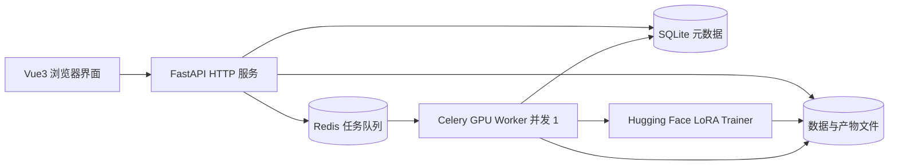
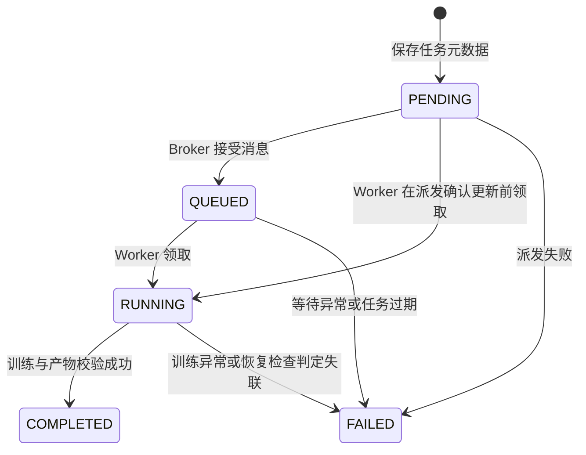

# 系统架构

## 一、组件与职责



该图描述 MVP 目标架构。M0 已实现健康检查、模型目录、元数据建表、Worker 配置和诊断任务；M1-02 已实现数据集服务层，M1-03 已接入真实数据集 HTTP API；M1-04 已在成员 B 工作台中验证真实数据集交互；业务训练与调度后续实现。

M1-01 已定义 [数据集接口与文件契约](api/datasets.md)，包含只读资源、原始字节 SHA-256 和相对 DATA_DIR 的存储键。M1-02 已落实共享扫描器、数据库迁移、文件服务和只读审计；M1-03 已实现路由和统一异常处理，详见 [HTTP 工作日志](worklogs/2026-10-21-m1-03.md)。

| 模块 | 输入 | 输出 | 职责边界 |
| --- | --- | --- | --- |
| `backend/app/api` | HTTP 请求 | JSON 或受控文件响应 | 校验、状态码与序列化 |
| `backend/app/services` | 已校验的业务参数 | 实体与调度结果 | 数据管理、状态转换和产物访问 |
| `backend/app/models` | ORM 数据/Schema | 持久化实体与接口类型 | 元数据结构和参数契约 |
| `worker/tasks.py` | 数据库任务 ID | 更新状态与产物元数据 | 领取任务、调用训练器、捕获错误 |
| `trainer/contracts.py` | 内部参数/JSON | 可校验的 Request/Progress/Result/Manifest/Failure | CPU-only 类型；不做文件或 GPU 操作 |
| `trainer/model_cache.py` | 根目录配置、模型 revision | 已校验 CachedModel/本地快照 | 显式下载与纯 CPU 离线校验分离，不依赖后端配置 |
| `trainer/train.py` | TrainRequest | TrainResult 与进度回调 | 模型训练，独立于 HTTP/Celery |
| `trainer/dataset.py` | 数据文件路径 | 校验后的训练样本 | 格式读取与验证 |
| `frontend/src` | API 响应与用户操作 | 页面与图表 | 轮询、上传、任务与结果展示 |

HTTP 中间件顺序为 request_id → CORS → 请求体限制/未知异常处理 → 路由异常 handlers。上传按 ASGI receive 的实际字节限制整个请求体，再用受限 multipart 解析器暂存文件；拒绝重复/未知 part 后，在线程池调用 DatasetService。持久化任务结束后关闭上传流，即使请求在保存期间被取消，也不能先关流打断文件事务。解析失败、断连或取消时释放表单缓存。临时缓存与服务写盘故障均映射为受控 503。

每个应用实例持有自己的 Settings、数据库 engine、Session 工厂与数据集服务；启动检查迁移再建新表，关闭释放连接。服务每次操作独占 Session；API 不持有跨线程请求事务。测试和 TCP 冒烟通过应用工厂使用临时存储。

API 进程不加载模型和执行 GPU 计算。Celery 消息仅包含任务 ID，不传输数据文件或模型权重。Trainer 接口不依赖数据库和 Celery。

## 二、训练调用与文件契约

M2-01 已交付 [内部训练契约 1.0.0](contracts/training.md)、Pydantic 校验类型和生成 JSON Schema/样例；train 仍是占位。下述 I/O/GPU 行为按 [M2 开发计划](m2-development-plan.md) 后续任务实现，不因类型验证通过就成立。

`train(request, on_progress) -> TrainResult`：

- `TrainRequest`：保留 task_id、dataset_path、output_dir、base_model、config，新增必填 model_revision/cache_dir/log_path，可选 validation_dataset_path/dataset_manifest_path 与 RuntimeOptions。
- `TrainingProgress`：step、total_steps、loss、learning_rate、epoch、recorded_at，kind 区分 train/eval。均按契约生成版本字段和 UTC 时间。
- `TrainResult`：adapter_dir、metrics_path、tokenizer_dir、config_path、manifest_path；类型检查同一目录布局，执行时返回前校验真实产物。
- M2 计划由 Trainer 唯一写入 metrics.jsonl，并在回调中提供同源真实指标；M3 Worker 消费回调更新数据库进度，不重复追加指标。回调不依赖 HTTP 请求生命周期。
- step 表示优化器更新步数，区别于微批次；加载阶段只输出阶段日志，无 Loss 时不生成数据点。训练与验证指标区分，未执行验证时不填充 eval_loss。
- Trainer 的配置类型保持 CPU 可导入，执行入口才加载训练库；路径/缓存参数由独立入口解析，不反向依赖后端 Settings。模型与 tokenizer 固定 revision，训练与重载使用一致模板。

类型位于 trainer/contracts.py，原 trainer.train 导入位置保留；新构造使用关键字，不再使用位置 dataclass。RuntimeOptions 默认 bf16、max_steps=null、local_files_only=true，不改变公共 TrainingConfig。路径校验不访问文件系统，不能替代真实路径/符号链接与配置根目录检查。

M2-02 已实现 scripts/prepare_model.py：prepare 将官方分支解析为固定 commit 并验证 9 个文件后原子保存缓存清单，check 对指定 commit 只读核对大小/摘要，不联网或加载训练包。HF_HOME 指缓存根，TrainRequest.cache_dir 指实际 Hub 缓存目录，默认 HF_HOME/hub；后续 Trainer 从 verify_model_cache 返回的 snapshot_dir 加载。真实基础模型的 BF16 GPU 前向已验证，见 [模型说明](model-cache.md)，不代表 LoRA 训练或 Adapter 重载已完成。

文件规划：

```text
data/
├── llmcloud.db
├── datasets/.tmp/{upload_id}.part      # 上传阶段私有临时文件
├── datasets/{dataset_id}/train.jsonl   # 校验成功后保存的原始字节
├── models/huggingface/                 # HF 缓存
└── outputs/{task_id}/
    ├── adapter/                       # adapter_model.safetensors 与 adapter_config.json
    ├── tokenizer/                     # 推理所需 tokenizer/template 信息
    ├── checkpoints/                   # 中间检查点
    ├── metrics.jsonl                  # 真实指标，逐行追加
    ├── training_config.json           # 配置快照
    └── manifest.json                  # 基础模型 revision、版本、结果清单
logs/
└── tasks/{task_id}.log
```

每个任务独立目录，禁止覆盖其他任务。M2 中先写入并校验产物，再原子写出成功 manifest 并返回 TrainResult；失败保留诊断但不能留下有效成功标记。manifest 记录版本、模型 revision、数据哈希/审核状态、配置、环境、统计与相对产物引用，不包含训练正文或本机绝对路径。新进程重载结果单独验收，不能在保存时提前记为重载成功。

M3 再将训练成功结果映射为数据库 COMPLETED。M4 Adapter 下载打包必要配置、tokenizer 和清单，不包含基础模型或原始训练数据。M2 的 CLI 重载验收不表示 M5 在线推理服务完成。

## 三、数据库与任务状态

初始表：

- `users`：ID、用户名、创建时间；MVP 单用户使用，认证尚未实现。
- `datasets`：ID、可选用户 ID、名称、原始文件名、SHA-256、存储路径、大小、记录数、创建时间。
- `training_tasks`：ID、数据集 ID、模型、训练参数 JSON、状态、Celery ID、进度与步数、产物路径、错误、创建/开始/结束时间。

SQLite 适合本地单 API/单 Worker。使用短事务、外键约束与 busy timeout，后续数据管理阶段按需启用 WAL。多进程部署和结构变更时引入 PostgreSQL 与 Alembic；M0 的 `create_all` 仅创建缺失表，不迁移已有表。

M1-02 已为 datasets 增加非空 original_filename 与 sha256，format 由服务层返回固定的 alpaca_jsonl。旧库由专用脚本显式备份/迁移；启动检测到旧结构会提示，不静默删库。服务按字段构建 DTO，SQLite 无时区时间按约定的 UTC 输出。



数据库是业务状态的唯一来源，不能将 Celery 的 `SUCCESS` 直接作为训练完成。使用条件更新领取任务，重复消息不会重复运行；API 更新 QUEUED 时只允许从 PENDING 转换，不能覆盖 RUNNING。此状态逻辑将在 M3 实现。

数据库提交与 Redis 派发不是同一事务。MVP 需要保留派发失败原因，并在启动/定时恢复检查中处理长期 PENDING/QUEUED/RUNNING；稳定性扩展阶段可采用 outbox。初始化不启用自动重试或晚确认，避免在没有幂等和恢复逻辑时自动重复训练。

## 四、GPU 资源与可观测性

- 一个 GPU 只启动一个 Worker，使用 `solo` 池、并发 1、prefetch 1，减少 CUDA 进程派生问题与排队任务占用。
- 多开两个并发 1 的 Worker 仍会争抢 GPU，必须在部署层限制 Worker 数量。
- 后续训练与推理共用主机级 GPU 锁，训练期间推理返回资源忙；单进程并发配置本身不足以约束其他进程。
- 初始 batch size=1、序列长度=512，按实测调整梯度累积与精度。显存峰值、训练耗时和吞吐量写入实验记录。
- 前端先每 2 秒轮询任务和增量指标；日志只读取有上限的尾部，暂不引入 WebSocket。
- 训练异常保存可读原因与任务日志，处理完成后释放模型引用与显存；无法安全恢复时重启 Worker。

## 五、部署演进

1. **本地 WSL2**：Vue 开发服务 + FastAPI + Redis + SQLite + 单 GPU Worker，全部共享仓库数据目录。
2. **单台云服务器**：反向代理 + 静态前端 + CPU API + Redis + GPU Worker；数据目录使用持久化挂载，API 与 Worker 使用相同逻辑路径。
3. **云端 CPU + 本地 GPU**：API、队列与 PostgreSQL 在云端，本地 Worker 通过私有连接消费队列；数据和产物通过对象存储传输，数据库保存对象键或 URI。Worker 下载到本地临时目录、完成后上传产物，API 使用对象存储提供下载。

混合部署不能共享 SQLite 文件或直接依赖云端本地路径。Redis 与数据库应通过受控网络连接，CPU API 不需要 CUDA，GPU Worker 镜像单独安装匹配的 PyTorch wheel。Docker 化完整服务属于后期阶段，目前 `compose.yaml` 仅提供本地 Redis。
