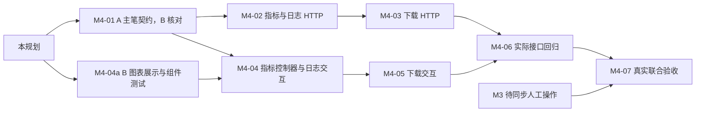

# M4 可观测性与 Adapter 交付开发计划

版本：执行计划 1.5；更新：2026-11-06（Asia/Shanghai）。M4-01 A 侧 CPU 类型/常量/格式样例已交付，B 消费者核对已审查收录；02 指标/日志 HTTP 已交付，03 下载已交付，04/05/06 已审查合入，07 待真实联合验收。正式类型/边界见 [观测契约 1.0.0](api/task-observability.md)，运行时指标/日志已发布，下载已实现。规划起点 main=25b2f52，01 开发起点 main=52d2974。

阅读入口：[协作约束](../AGENTS.md)、[项目记忆](project-memory.md)、[总计划](project-plan.md)、[训练契约](contracts/training.md)、[任务契约](contracts/tasks.md)、[产物审计](training-artifacts.md) 和 [M3 审查](worklogs/2026-11-04-m3-07-a-review.md)。

## 一、目标、现状与范围

M4 将已经保存的真实指标、任务日志和有效产物接入浏览器：训练时观察 Loss 与阶段日志，失败后保留可用证据，完成后下载可独立审计的 Adapter 包。继续使用单用户、单 GPU、SQLite、本地文件、FastAPI 与 Vue，不增加基础设施或图表依赖。

| 已有事实 | M4 的直接影响 |
| --- | --- |
| Trainer 在 data/outputs/{task_id}/metrics.jsonl 写入 TrainingProgress，write/flush 后才回调 Worker | HTTP 只读原文件，不能重复写指标、重新计算 Loss 或以数据库步数代替指标 |
| 同一 step 可有 train/eval；服务创建暂不接收验证集 | 两类记录不能互相覆盖；默认服务只有真实 train 点，不新增验证集接口或补造 eval |
| LOG_DIR/tasks/{task_id}.log 为 Trainer 的 JSONL 阶段/指标/安全失败日志 | 展示的是该任务阶段日志，不是共享 Celery stdout 或完整框架控制台输出 |
| TaskDetail 已有状态/进度/config，无 last_loss；完成行已有 output_key、manifest_sha256、training_summary 及固定快照 | 不新增数据库列；最新 train Loss 从指标取得；下载新增内部只读投影，不改变 Worker 五方法 Protocol |
| trainer.artifacts.verify_training_artifacts 可在无 torch/numpy/HF 的 CPU 环境检查完整 bundle | 复用审计及正式类型，不另写一套简化的“目录存在即成功”检查 |
| B 04 已替换 after_step/Map(step)，图表支持 train/eval | 按 source_id/offset 合并、返回 cursor 续读；不回退旧猜测或重写 M1/M3 |
| B 05 已固定点击 UUID 并补齐完整 body 的 timeout/abort | 保持任务切换/旧响应隔离，基本 ZIP 门禁不代替后端审计 |
| 02 已将任务 OpenAPI 扩展到全部实际任务子路径 | 指标/日志已发布，下载已由 03 实现；不登记假的已实现路由 |

本阶段包含三个 GET 接口、增量曲线、有限日志尾部、ZIP 下载、必要失败处理和真实联合验收。不做在线推理/生成、取消/恢复训练、自动重训、SSE/WebSocket、Prometheus、多租户、对象存储、下载历史库或持久化下载缓存。正式语料/效果实验仍独立推进。

### M3 的未完成项如何处理

M3 的真实自动运行、B 异步证据/既有页面复核和 A 审查已通过；双方从新上传到 GPU 完成的同步人工操作仍未执行。M4 可在此稳定基线上规划和开发兼容的新能力，M3 状态继续保留为待共同验收。若该人工操作发现业务阻塞，优先修复并重查受影响接口。

可以把 M3 人工操作与 M4-07 安排在同一实际服务/GPU 时段，分别记录原任务流程与新观测/下载结果，不重复计算预算或把安排当作执行。M4 最终收口前须有该人工过程的实际记录。

## 二、任务拆分、分工与预算

A 为当前侧/你，主负责后端/共享契约；B 为队友，主负责现有前端。估算为团队人时，不是每人耗时。主线 18 人时（A 10、B 8），双方各预留 2 人时缓冲，共 22 人时；按每人每周 6–8 小时，约 1.5–2 周。W4 的 11/09–11/15 保留为原排期基线，不虚构双方已约定的个人截止时间；超时应调整剩余估算，不能删去真实验收。

| 编号 | 主负责与人时 | 依赖 | 交付/主改文件（完成状态见正文） | 通过条件 |
| --- | --- | --- | --- | --- |
| M4-01 共享契约 | A 1.5 + B 0.5 = 2 | 本文和现有类型 | core/observability_contract.py/observability_protocols.py、models/observability_schemas.py、统一错误枚举；正式接口文档、生成 Schema/mock 样例和导出检查 | A 类型/生成样例和 B 独立核对均已审查完成，wire 1.0.0 无变更 |
| M4-02 指标与日志 API | A 4 | 01 | services/task_files.py、task_observability.py；api/task_observability.py、main 装配与 HTTP/文件边界测试 | 已交付，见 [02 日志](worklogs/2026-11-04-m4-02-a.md)；有界读取/半行/两 kind/游标/投影/缺文件和运行时 OpenAPI 检查通过 |
| M4-03 下载 API | A 3 | 01；路径辅助复用 02 | task_repository 新增只读完成产物投影；services/task_download.py、下载路由/响应生命周期与测试 | 已交付，见 [03 日志](worklogs/2026-11-05-m4-03-a.md)；SQL/原审计/打包字节一致，失败统一 JSON、取消/断连清理通过 |
| M4-04 曲线与日志 UI | B 4 | 展示准备可先做；请求适配依赖 01 | LossChart.vue、TasksPanel.vue、新 task-observability.js、组件/控制器测试 | 已审查合入，见 [A 审查](worklogs/2026-11-06-m4-b-review.md)；train/eval 分开；按记录身份合并、终态补拉、任务切换/错误隔离、日志真实且有上限 |
| M4-05 下载交互 | B 1.5 | 01；复用 04 的任务生命周期 | TasksPanel.vue、api.js 或专用 task-download.js、对应测试 | 已审查合入，见 [A 审查](worklogs/2026-11-06-m4-b-review.md)；固定任务 ID；覆盖 blob 全程的取消/超时；合法 ZIP 保存、JSON 错误展示、重复点击保护 |
| M4-06 跨模块回归 | B 1 + A 0.5 = 1.5 | 02～05 实际接口可用 | 独立 HTTP/浏览器检查、CPU CI 和测试说明；A 提供隔离服务/文件场景，B 不复制 SQL | 已审查合入，见 [A 审查](worklogs/2026-11-06-m4-b-review.md)；真实 HTTP/类型/前端响应一致；失败矩阵通过；M1/M3 回归不退化，替身只用于明确隔离测试 |
| M4-07 真实联合验收 | A 1 + B 1 = 2 | 02～06 | 隔离真实训练、页面操作、下载后审计、双方日志和状态收口 | 活任务观察、终态最后记录、真实 ZIP 核验及 M3 人工流程有证据；无未解释的阻塞问题 |

当前 01～06 已交付并经 A 复跑接受，ef1fe06 已快进合入；07 真实 GPU/双方人工待执行。每笔交付包括小提交、独立 YYYY-MM-DD-m4-XX-a.md / -b.md、已测/未测与接续说明。02 有真实接口/文件服务和 CPU/TCP 验收；03 下载已实现，未创建 GitHub Issues。

## 三、怎样并行，以及两人现在分别做什么

01～06 已交付，ef1fe06 经 A 本机审查/CPU/实际 HTTP/页面检查后快进合入，wire 仍为 1.0.0；见 [审查](worklogs/2026-11-06-m4-b-review.md)。A 已交付 07 专用编排和非 GPU 检查（见 [日志](worklogs/2026-11-06-m4-07-a-tools.md)），B 并行准备人工清单/访问，两方再约定共用服务/GPU 时段。M3 人工待办、M4-07 GPU/页面联合验收不因此完成。

### A：01～06 审查完成，接续 07 验收编排

已交付 CPU 类型/常量/头描述、内部完成 DTO/只读 Protocol、正式文档及生成格式样例/--check。B 已按 [消费者清单](api/task-observability.md) 核对 source_id/cursor、空数据、终态补拉、日志过滤和下载头，约 30 分钟计入 01 人时，实际反馈见 B 的 01 独立日志并经 A 收录；没有代签。02/03/04/05/06 均已交付，A 下一步实现 07 编排，见 [联合安排](m4-acceptance.md)。API/服务不得加载模型、修改 Trainer 文件或索要客户端路径。

01 正式文档为 [task-observability.md](api/task-observability.md)，类型/27 个格式 fixture 及索引/说明由 scripts/export_observability_contract.py 生成到 docs/contracts/observability.schema.json 与 docs/examples/observability/；均已存在，标记类型样例而非 HTTP 证据。接口新增是 /api/v1 的兼容扩展，不修改 TaskCreate/TrainingConfig/TaskDetail 或 M2 事件格式。M3 任务契约仍为 1.0.0，新观测契约单独从 1.0.0 起步；不兼容变更须重新核对版本和样例。

### B：04a/04/05/06 已交付，接续人工准备

已有 LossChart 与相应测试已实现：输入采用已有事件的 kind/step/loss，train/eval 分色与图例，同 step 的两个点都保留；覆盖 Loss=0、单点和空记录。曲线不平滑、不补点，不将“没数据”绘制成零。此准备不依赖 HTTP，也不要求先改 API 返回字段。

真实页面继续受 OpenAPI 能力探测控制；样例只放组件测试，不能往产品页面注入假曲线。五份独立日志已审查收录，04/05 已按正式契约接入且 06 实际 HTTP 通过；不重复领取这些任务。B 现在准备人工清单、访问方式和独立记录，与 A 约定共同操作时段。

### 必须保留的共同检查

01 字段核对和 06 实际 HTTP 对齐已经完成；07 同一服务/GPU 的双方人工操作仍需配合。B 可以用定稿 fixture 完成请求控制器和 UI 测试，不等后端全部完成；但不能用这些测试代替真实服务验收。具体截止、中途同步和 GPU 时段由双方约定并记日志，阻塞约 30 分钟时反馈接口/复现步骤，而非继续猜测。

## 四、M4-01 接口摘要（以正式类型/文档为准）

以下为 [正式观测契约 1.0.0](api/task-observability.md) 摘要，CPU 类型已实现、B 核对已审查收录；02 指标/日志执行已实现，03 下载已实现。参数/字段/上限/错误若调整须同步本文、正式文档、类型和生成样例，并按兼容性更新独立观测版本，不由两人各改一套。所有接口继续查数据库中的任务身份，成功直接返回资源，失败沿用 ErrorResponse/X-Request-ID；SQL 读取失败不能伪装成空数据。

### 4.1 GET /api/v1/tasks/{task_id}/metrics

不使用 after_step。游标是读取位置，step 是优化器更新步；M2 metrics.jsonl 不增加游标字段，HTTP 只在返回时包装。

| 请求参数 | 方案 |
| --- | --- |
| cursor | 非负安全整数，默认 0，最大 2^53−1；表示已消费的完整行之后的 UTF-8 字节偏移 |
| source_id | 首次可省略；cursor>0 必须携带上次返回的非空文件版本标识；64 位小写十六进制字符串，不是授权凭证 |
| limit | 默认 200、范围 1～1000 条 |

| 响应字段 | 方案 |
| --- | --- |
| contract_version / task_id / task_status | 新观测契约版本、任务 UUID、读取时观察到的数据库状态 |
| source_state | ready 或 not_created；空文件存在属于 ready |
| source_id | 当前文件身份标识；未创建时 null，不包含服务器路径 |
| items | TrainingProgress 原字段，额外添加 offset（该完整行起始字节）；按物理记录顺序返回 |
| next_cursor | 最后一条返回记录完整换行之后的位置；无新完整行则保持输入 cursor |
| has_more | 本次观察到的文件范围内，是否还有未返回的完整记录 |
| tail_incomplete | 当前尾部有未完成行；必须明确告知，不能把其当成有效点 |

source_id 根据任务/文件身份生成并在正常追加时保持稳定；不能把每次追加都会变化的 mtime/长度当作版本。仅保证识别文件身份变化和 size<cursor 的截断，首版不宣称能识别任意同 inode 的历史篡改；完整成功产物的防篡改核对由原审计负责。游标必须位于行边界；版本不匹配、旧游标指向消失/截断文件返回 409/METRICS_CURSOR_INVALID，让客户端明确重置，而非默默混合两份曲线。

单次从起始偏移最多扫描 512 KiB，完整指标行上限沿用审计的 16 KiB；不从文件头重扫历史、不一次 read_text 整文件。预算内预留一行探测 has_more，不能把未完成尾行标成有新完整记录导致同游标空转。达到条数/扫描预算就停在完整记录边界，序列化响应上限 1 MiB。解析复用 TrainingProgress，拒绝重复 JSON 键、非有限数值/非法 UTF-8/无效完整行，不能跳过坏记录继续报成功；读到半行不推进游标，等后续追加。COMPLETED 出现半行/空指标文件是损坏；异常中断 FAILED 可返回前面完整记录及 tail_incomplete 提示。

自然缺文件仅在 cursor=0、current_step=0、非 COMPLETED 的尚未产出场景返回 200/not_created/空数组。COMPLETED 或已知有训练记录却缺文件，应返回明确错误，不能清空曲线掩盖。任务不存在即 404，即使磁盘上碰巧存在同名目录也不绕过 SQL。

注意 MetricWriter 先 flush 再回调 SQL，因此文件里的 step 可以暂时领先 TaskDetail.current_step；两次请求不是同一事务，不能据此删点或伪造状态。指标只决定曲线，数据库决定业务状态。get 到终态后还需按 has_more 补齐最后完整记录。

### 4.2 GET /api/v1/tasks/{task_id}/logs

首版使用有限尾部快照，不再另做日志增量协议。tail 默认 100，范围 1～500，表示窗口内最后 tail 个完整源行先被选中再作投影，不因过滤补读旧行。返回 contract_version/task_id/task_status/source_state、lines:string[]、truncated:boolean、tail_incomplete:boolean、filtered_lines:非负整数（不大于本次 tail，类型全局最大 500）。source_state 同上；尚无日志时不是任务成功证明，错误主信息仍读取 TaskDetail。

从文件尾最多读 64 KiB，最多返回 tail 行，序列化响应上限 256 KiB；截断窗口开头不完整行不冒充完整记录。truncated 表示更早内容被省略；前端替换整个尾部快照而非拼接重复行。尾部未写完可等待后续轮询；过长/无法安全解析的行作明确过滤计数，不静默伪造完整日志。

只读 LOG_DIR/tasks/{UUID}.log，不返回共享 Worker stdout、lock 或路径文本。按已有 Trainer 日志种类采用安全字段白名单：阶段/时间/任务 ID、精度、真实指标、参数数目、数据摘要、failure 的 task_id/code/stage 和受限 basename 栈位置（不透传自由文本 message，说明见 TaskDetail）；不透传训练正文、凭据、完整文件路径或任意新增原始异常字段。格式化结果仍作为 lines 文本展示，未知/不合规内容按记录计入 filtered_lines，一行最多一次；字段策略与样例由 01 提供，02 已实现值校验/安全投影。前端以文本渲染，不用 v-html。

尚未进入 Trainer 的失败任务可能没有此文件（例如 Worker 的数据/缓存预检查失败），允许 200/not_created；COMPLETED 或已知产生日志后丢失/不可读则显式报错。I/O、符号链接或路径越界不能被解释为“等待日志”。

### 4.3 GET /api/v1/tasks/{task_id}/adapter

只接受服务端任务 ID，不接路径/文件名/归属。不存在 404；非 COMPLETED 为 409/ARTIFACT_NOT_READY。进度 100% 但 RUNNING、存在 Adapter 目录但 SQL 未完成，都不满足下载条件。

SQL 仓储已新增内部只读 get_completed_artifact(task_id)，不存在/未完成分别明确抛出。其 DTO 组合已有 TaskExecutionSpec、output_key、manifest_sha256、training_summary；不传 ORM 对象、不增加数据库列、不改 Worker TaskRepository 五方法 Protocol。

下载顺序：

1. 短事务取得完成快照并释放；所有路径由受控根和 UUID/存储键构造，拒绝符号链接/junction/异常硬链接/非普通文件与越界。
2. 取得单 API 进程内的下载槽位，比较 SQL manifest 哈希、任务/模型 revision、config/runtime、数据集快照、training_summary；读取 manifest 有 512 KiB 上限，原白名单目录的元数据/声明总量先检查 256 MiB 上限，再读权重。不能只对比 UUID 或信任 SQL 的 COMPLETED。
3. 在独立 DATA_DIR/downloads 私有临时工作区按 64 KiB 安全复制并核对源哈希，再对隔离副本调用原完整 CPU 审计；原审计器按路径读取，隔离副本避免活源替换绕过预检。ZIP 也在该临时区，不往原 outputs/{id} 放 ZIP 或额外文件；单次额外磁盘最高约 512 MiB 加元数据。保留父目录 fd 直至清理。
4. 只打包已审计 manifest.artifacts 加 manifest.json，文件名使用规范相对路径。实际复制时流式复核大小/哈希，拒绝审计后到打包前的内容变化，不在 ZIP 中加入输入数据、基础模型、checkpoint、failure.json、源日志或本机路径。
5. 完整 ZIP 准备好且已核验后再发送。此前任何错误返回统一 JSON；开始发送后断连/读失败只能结束传输，不能再追加一段错误 JSON 冒充 ZIP。
6. 正常、失败、取消和断连均关闭句柄并清理本次临时文件、释放槽位，以实际生命周期测试证明。进程强杀遗留可停 API 后人工清理专用下载临时目录，不引入后台清理服务或承诺崩溃自动清理。

包名 llmcloud-adapter-{UUID}.zip，MIME application/zip；ZIP 顶层为 {UUID}/，下面保持 adapter/、tokenizer/、metrics.jsonl、training_config.json、manifest.json 的相对布局。响应 Content-Disposition 为 attachment，设置 no-store，CORS 暴露 Content-Disposition/X-Request-ID/Retry-After；错误仍为 ErrorResponse。服务端文件名由 UUID 生成。

首版单 API 进程、同时在途下载上限 1（覆盖打包至响应清理），忙时 429/DOWNLOAD_BUSY，Retry-After=2。未压缩文件总量上限 256 MiB，在大读取/审计前检查，超限 413/ARTIFACT_TOO_LARGE；流式写入再次核对实际量。ZIP 不放入内存，重请求重新核验，不建立持久缓存。下载以前的完成任务不占 GPU 锁，可与另一个实际训练任务并行；仅下载槽位互斥，不阻止观测读取。

下载后解压到独立 <验收data>/outputs，再使用原 scripts/check_training_artifacts.py --task-id {UUID} --data-dir <验收data> 独立审计。M4 不要求下载触发生成或再占 GPU；重载/在线推理沿用 M2/M5 的边界。

### 4.4 错误与发布方式

| 条件 | 拟定 HTTP/code |
| --- | --- |
| 任务不存在；SQL 不可用；字段/重复/未知参数错误 | 沿用 404/TASK_NOT_FOUND、503/DATABASE_UNAVAILABLE、422/VALIDATION_ERROR |
| 旧指标游标/文件版本不一致 | 409/METRICS_CURSOR_INVALID |
| 指标完整行损坏；应有的指标/日志不可读 | 500/METRICS_CORRUPTED、METRICS_UNAVAILABLE、LOGS_UNAVAILABLE |
| 未完成；完整产物不匹配/缺失 | 409/ARTIFACT_NOT_READY；500/INVALID_ARTIFACT |
| 下载量超限；下载槽位忙 | 413/ARTIFACT_TOO_LARGE；429/DOWNLOAD_BUSY，Retry-After=2 |
| 临时存储 I/O 失败 | 500/STORAGE_UNAVAILABLE，安全说明，不泄露本机路径 |

新 code 已在 01 纳入 ApiErrorCode 和生成 Schema，B 消费核对已审查收录，不解析中文 message 判断条件。共享枚举改变时重导出受影响的原数据集/任务 Schema 和样例。API 查询继续拒绝重复/未知项；现 parse_query 只特别处理 page/page_size，02 已用对应查询类型落实 cursor/limit/tail 的严格整数校验并回归 M3，不依赖宽松浮点转整数。

01 仅导出类型/mock 样例；02 已扩展 export_task_openapi.py 从真实 app.openapi() 导出实际任务子路径，包含指标/日志，下载已由 03 实现。不手写另一套运行时 OpenAPI。B 只启用实际发布的接口，单接口出错不影响 TaskDetail，失败不回退虚构指标。

## 五、前端控制器与交互要求

建议将观测请求状态从 TasksPanel 抽出到 task-observability.js，复用已有请求序号/AbortController/可见性机制。每个任务独立保存 source_id/cursor、点集、日志、错误与加载状态；切换任务清理/取消，旧成功、失败及 finally 均不能更新新任务。M1 上传、M3 创建/去重/筛选/分页逻辑不重写。

TaskDetail 仍是界面业务状态入口，观测响应中的 task_status 只是该次读取的 SQL 快照，不能用迟到的 RUNNING 覆盖已更新的终态详情。

- 用 (source_id, offset) 标识记录并合并；不能用 step 或最新数组长度作游标。按 kind 分系列、step 作横轴，允许 train/eval 相同 step；最新训练 Loss 只选最后一条 train，不把末尾 eval 误标为训练 Loss。
- 加载期无指标、终态未产出指标、Loss=0、无 eval、单点和读取错误分别处理。终态没有指标不继续显示“正在等待训练”；无 eval 不画零线，不使用定时器补进度或插值点。
- 约 2 秒轮询；页面隐藏/切出详情暂停，重新进入从既有游标补拉。每轮最多补 5 页，has_more 仍真则标注“正在补拉”并在后续有界轮次继续，不能无限循环或阻塞界面。
- UI 最多保留最近 10,000 条观测记录，并明确提示展示窗口，完整指标在下载包中保留；不声称有限窗口是完整历史。协议响应非法时显示 INVALID_RESPONSE，不静默丢坏点或猜字符串/数组两套格式。
- 终态停止 TaskDetail 周期查询，但观测控制器还要补完 has_more 并取一次最终日志尾部再停止。100% RUNNING 继续显示等待保存/提交，不提前启用下载。
- 日志作为真实有限快照，展示 truncated/tail_incomplete/filtered_lines；刷新替换文本，用户查看历史时不强行滚到底，提供回到底部入口。
- 下载点击先捕获 task_id/文件名/本次序号，支持仍在请求阶段的取消与重复点击保护；切换任务后旧请求不更新新任务状态，不能在 await 后用 selected.id 给旧文件命名。
- request 的 blob 分支须等待响应体完成才清理超时/abort 监听；检查成功 MIME，错误 JSON 正常展示，不能把错误页面另存为 ZIP。可新建专用 helper，保留现有 M1/M3 request 调用约定。文件名可从已捕获 UUID 安全生成，若读 Content-Disposition 则限制为安全 basename。

现有 61d8703 的任务失败提示与手机侧栏/横向滚动保持可用，新增图例/日志/按钮需在桌面及 390px 检查。夹具只用于隔离测试，真实页面始终查询实际接口。

## 六、主改文件、提交与合并边界

| 文件范围 | 主改 | 交接规则 |
| --- | --- | --- |
| 新 CPU DTO/常量、ApiErrorCode、正式文档、生成 fixture/Schema | A，B 核对 | 01 小提交先稳定；字段/错误/上限变化同笔更新，不各自复制 |
| task_files、task_observability、task_download、只读仓储投影、HTTP、main/CORS/OpenAPI 导出 | A | 02/03 分开提交；B 不写 SQL、不复制路径/审计算法 |
| LossChart、TasksPanel、新观测/下载控制器、api.js、前端测试 | B | 04a 可先合入；04/05 在定稿 fixture 上独立完成，保留其他页面 |
| 测试服务/黑盒 HTTP/浏览器检查与 CI | 06 B 主，A 支持 | 先确认隔离场景/运行入口；只调用正式仓储/接口或明确替身，不复刻训练器 |
| README、AGENTS、项目记忆/计划/架构/需求、日志索引 | A 汇总 | B 写自己的独立日志和 frontend 使用说明，双方合并后核对状态 |

建议 A 使用 feature/m4-observability-api，B 使用 feature/m4-observability-ui；各用独立 checkout/worktree，临时 DB/服务端口/队列分离。只读模型缓存可以共用，但 GPU 运行一次只由一方组织、共用 LOG_DIR/worker.lock。API 文件读取/下载不去获取该 GPU 实例锁，否则会阻塞训练中的观测。

开始、每个独立部分完成、提交/推送前均 fetch 并读新增提交/日志；先审查，再在干净工作区正常快进，分叉则保存自己的提交后正常 merge，逐项解决并重查。不要等两个大分支都完成才第一次合并：01 → 04a → 02/03 与 04/05 各自合入 → 06 → 07。当前有 01 类型及 02 真实指标/日志接口；其余不创建空业务入口。

## 七、测试矩阵与完成定义

| 层次 | 必测行为/失败 |
| --- | --- |
| 指标读取/CPU | 相同 step 的 train/eval、分页边界、重复取页不丢不重、空文件/自然缺文件、行刚写一半、append、旧版本/截断、非法 JSON/UTF-8/非有限值、超长行/预算、非法/重复参数、SQL 不存在/不可用 |
| 日志读取/CPU | 100/500 行边界、64 KiB 尾部、长行/尾部半行/未知字段过滤、任务无日志、COMPLETED 日志丢失、I/O/符号链接/越界、安全文本及 XSS 样例 |
| 下载/CPU/HTTP | 五状态门禁、SQL/manifest/config/runtime/数据摘要不符、文件丢失/改动/链接、包布局/CRC/哈希、大小上限、忙/磁盘失败、客户端取消/传输异常清理、旧完成任务下载不抢 GPU 锁 |
| 前端隔离测试 | 单点/零 Loss/无 eval、同 step 两线、旧响应/finally、游标重置、终态最后一页、隐藏恢复、日志截断提示、下载时换任务、延迟 blob 的 timeout/abort、错误 MIME/JSON、重复点击 |
| 实际 HTTP/浏览器 | 运行时 OpenAPI 与参数/错误/headers 一致，真实文件追加时页面更新，终态补齐、失败保留可用记录、ZIP 真实下载、M1/M3 既有场景回归 |
| 真实 GPU/联合操作 | 实际 Worker/Trainer 写文件，人工页面查看并核对原指标/日志；真实下载后独立 CPU 审计；不以 CPU 合成 bundle/事件替身冒充 GPU |

沿用 CPU CI；实施时按改动范围运行 Python 测试、npm test/build/test:e2e、原四项契约 --check 及新增观测类型检查。新增端点不应在 API 导入时加载 torch/numpy/HF，CPU 环境实际检验。文档规划不要求运行训练；读完代码和计划不算行为验收。

M4-07 使用独立 DATA_DIR/SQLite/Redis、共用物理 GPU 锁和固定 0.5B revision。先提交同步已通过 CPU 检查的代码，在干净工作区记录代码版本后组织真实运行。训练显式标为工程样例，内部 max_steps 按实际耗时设置（可从 20～40 步起），公开请求不增加 max_steps；logging_steps=1，至少形成 5 个真实点，并跨过两轮轮询。太快时调整实际步数并记录，不通过延迟/假点制造过程。默认没有验证集，真实联合验收不要求凭空出现 eval；两 kind 同 step 用明确的受控用例验证。

记录提交/配置/任务 ID/UTC 起止、实际页面操作、原指标与日志、下载 SHA-256、解压后的共享审计结果以及失败/未测范围。若同场补 M3 人工流程，分别写清两阶段通过项。新证据仍默认放 Git 忽略目录；M3 两个固定证据文件的特例不自动扩大到 M4。

- [x] 01 A 侧类型、边界、生成 fixture/漂移检查已实现且 CPU 可导入。
- [x] 02 指标/日志只读服务、真实 HTTP/OpenAPI、有界文件/安全投影及 CPU/TCP 检查已交付。
- [x] 03 完成只读 SQL 快照、原 CPU 审计/ZIP/资源限制及取消/实际 TCP 断连清理已交付。
- [x] B 按实际 01 类型/样例完成消费者核对并记录，两方差异已处理，未变 wire 1.0.0。
- [x] 06 指标/日志/下载实际 HTTP 与 OpenAPI 一致，CPU 事件/bundle 的错误/资源界限通过。
- [x] 04/05/06 UI 不丢同 step 两类记录，旧请求隔离及终态最终记录可见（CPU/HTTP）。
- [x] CPU bundle 的完成任务下载布局/哈希/原审计通过，失败/未完成任务不能下载；真实 GPU 下载另在 07 记录。
- [x] M1/M3 和本阶段受影响 CPU/HTTP/浏览器回归通过，代码/文档/各自日志已收录；不代替 M3 人工剩余项。
- [ ] 双方实际服务/GPU 人工过程有记录，M3 剩余项和 M4 新能力分别确认。

满足后才将 M4 标为完成。Loss 是否下降、回答是否改善不属于本阶段的通过条件；M5 的在线推理、正式效果实验和云部署继续独立规划。

## 八、当前下一步

M4-07 工具及非 GPU 检查已交付，剩余实际 GPU 和双方人工操作；详细 [联合安排](m4-acceptance.md) 列出了 A/B 可并行准备、必须共同完成的步骤和证据要求。专用脚本及非 GPU 检查已交付，见 [日志](worklogs/2026-11-06-m4-07-a-tools.md)；当前没有新的 GPU 或双方人工通过记录；不把 CPU 联调标为全阶段完成。
